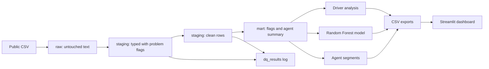
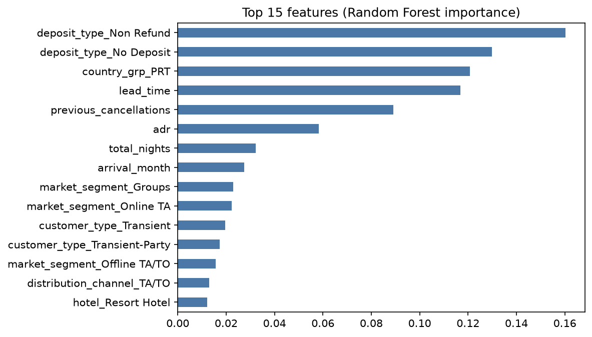
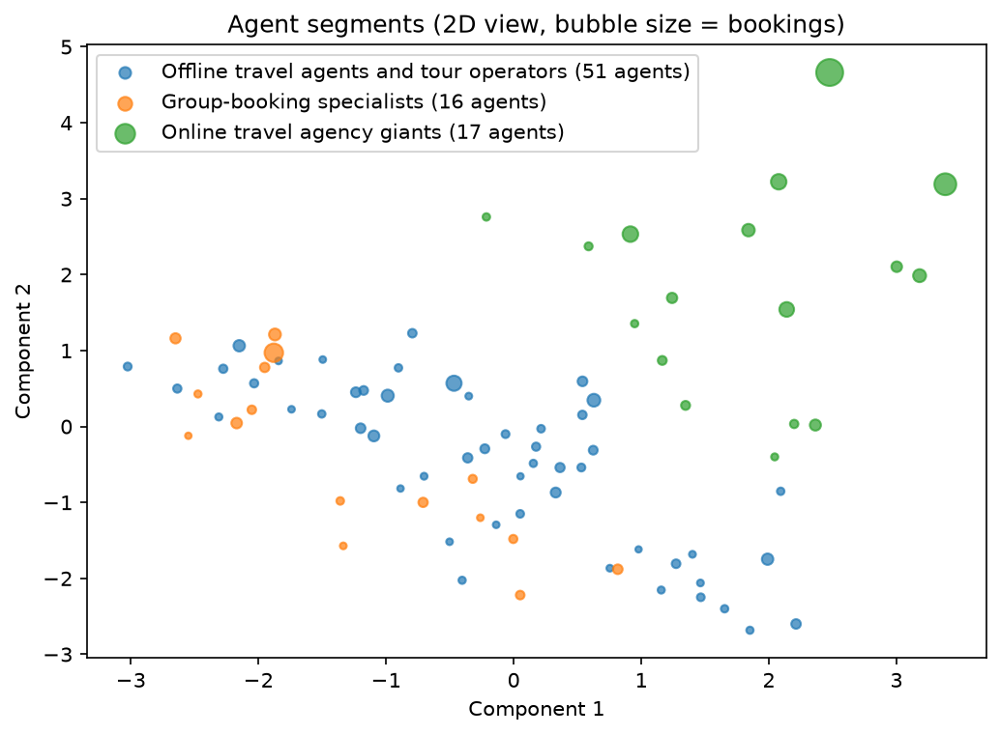

# Hotel Booking Cancellation and Agent Analytics

A personal portfolio project using a public dataset (not employer work). It asks: which bookings and which booking agents are most likely to cancel, and what should a hotel do about it?

**Tools:** SQL, Python, DuckDB, scikit-learn, Streamlit, Git/GitHub

<!-- Add this line once the dashboard is deployed:
**Live dashboard:** https://your-app-link-here
-->


## Key findings

Overall, 37.1% of the 119,209 cleaned bookings were cancelled: 41.8% at the City Hotel and 27.8% at the Resort Hotel.

1. **Lead time is the clearest booking-time signal.** Cancellation rises steadily with lead time in every year. Across all years, bookings made 181+ days ahead cancelled at 57.0%, versus 9.6% for bookings made within a week. The 181+ rate has fallen over time (74.3% in 2015, 54.4% in 2016, 51.5% in 2017, when 0-7 day bookings cancelled at 8.7%), so the exact figure is not constant.
2. **Sales channel matters.** Travel agent and tour operator bookings cancelled at 40-43% in every year, versus 17-18% for direct bookings.
3. **Non Refund bookings distort the picture.** They cancel at about 99% in every year, which looks like a recording quirk, and they are concentrated in certain agent segments. A group-booking segment that first looked like the riskiest (65.9% cancelled) drops to 32.4% once these are excluded, which changed my recommendation for it.

## Recommendations

- **Long-lead bookings (181+ days):** send reconfirmation reminders or ask for a partial prepayment, since about half of them cancel.
- **Online travel agencies:** among the 84 agents with 100+ bookings, 17 online agencies account for 65% of bookings and about 57% of cancellations. Small improvements here have the biggest impact, so target reminders at their long-lead bookings.
- **Group-booking agents:** investigate how Non Refund bookings are recorded before acting on their cancellation rate. Use rooming-list deadlines to manage their long lead times (185 days on average).
- **Offline agents:** these have the lowest underlying cancel rate (17.5% excluding Non Refund). Protect the relationship and test resort-stay offers.

These patterns are associations in historical data, not proven causes. Any intervention should be tested.

## The data

- **Source:** Antonio, N., de Almeida, A., and Nunes, L. (2019). *Hotel booking demand datasets.* Data in Brief, 22, 41-49. https://doi.org/10.1016/j.dib.2018.11.126. I used the copy published by TidyTuesday: https://github.com/rfordatascience/tidytuesday/tree/master/data/2020/2020-02-11
- **Contents:** 119,390 bookings from two hotels in Portugal (a resort in the Algarve and a city hotel in Lisbon), with arrival dates from July 2015 to August 2017. Identifying details were removed by the authors.
- **After cleaning:** 119,209 bookings. I removed 181 rows with impossible values (zero guests, negative prices, or missing key fields).

## Pipeline



- **raw:** the file loaded as text, exactly as downloaded. Never edited.
- **staging:** proper data types plus a flag on each problem row, then a clean table with the bad rows removed. Row counts are reconciled between layers.
- **mart:** analytics-ready tables with business-rule flags (for example, `is_long_lead_booking`) and an agent summary.

### Data quality checks

Every build runs checks and writes the results to a `dq_results` table, shown on the dashboard's last page. Checks cover: missing or negative lead time, invalid cancel flags, unrecognized month names, missing children, country, and agent values, zero-guest bookings, negative prices, zero-night stays, exact duplicate rows, and row-count reconciliation across layers.

- 181 rows (0.15% of the raw file) failed at least one check and were removed.
<!-- Add 2-3 specific counts from your dq_results table here, e.g. "N zero-guest bookings" -->
- Exact duplicate rows were flagged but not deleted, because the file has no booking ID to prove they are the same booking.

## Prediction model

A Random Forest predicts cancellation using only information known at booking time. It was trained on 2015-2016 arrivals (78,590 bookings) and tested on 2017 arrivals (40,619 bookings). A time-based split avoids letting the model see the future.

| Approach | Bookings flagged | Precision | Recall |
|---|---|---|---|
| First rule: no deposit and lead time over 100 days | about 37% | 0.40 | 0.38 |
| Rule: lead time over 180 days | 20.7% | 0.52 | 0.28 |
| **Random Forest, 0.5 threshold** | **20.7%** | **0.82** | **0.44** |
| Random Forest, 0.3 threshold | 50.8% | 0.62 | 0.81 |

- ROC AUC is 0.84. "Predict nobody cancels" scores 61% accuracy on the test set, which is why precision and recall matter more than accuracy here.
- At the same 20.7% of bookings flagged, the model is right 82% of the time versus 52% for the best simple rule, and catches about 60% more cancellations.
- A low threshold suits cheap actions such as reminder emails. A higher one suits costly actions such as deposit requests.
- My first rule (no deposit and long lead time) barely beat chance, so I replaced it. Testing a rule before trusting it was worth the time.



### Choices and robustness

- **Leakage:** I left out fields that reveal the outcome or are filled in after booking (`reservation_status`, parking requests, booking changes, assigned room type).
- **Prior-cancellation fields:** `previous_cancellations` behaves inconsistently across years. Guests with a prior cancellation cancelled 99%, 85%, then 17% of the time in 2015, 2016, and 2017. I treat this as a likely recording change and excluded the field from the model, which scored the same without it (AUC 0.836 vs 0.838).
- **Non Refund bookings:** removing them lowers AUC to 0.78, so part of the headline score comes from that group.
- **Special requests:** adding them raises AUC to 0.85, but they can be added after booking, so I kept them out of the main model.

## Agent segments

K-means grouped the 84 agents with 100+ bookings using behavior only (volume, lead time, price, stay length, deposit and market mix), not cancel rate. The groups are stable across reruns (ARI 1.00), but separation is modest (silhouette 0.24), so treat them as a practical grouping, not distinct natural clusters.

| Segment | Agents | Share of agent bookings | Cancel rate | Excl. Non Refund | Avg lead time | Main market |
|---|---|---|---|---|---|---|
| Offline travel agents and tour operators | 51 | 21.4% | 36.1% | 17.5% | 119 days | 88% offline TA/TO |
| Group-booking specialists | 16 | 13.7% | 65.9% | 32.4% | 185 days | 85% groups |
| Online travel agency giants | 17 | 64.9% | 34.8% | 34.7% | 78 days | 67% online TA |



## Dashboard

Four pages: overview and drivers, agent lookup, segments, and model and data quality.


## Limitations

- Results describe two Portuguese hotels in 2015-2017 and may not generalize.
- Non Refund bookings cancel at about 99% in every year, and I cannot explain why from this data.
- The 2017 test set covers only part of a year, and I chose illustrative thresholds by looking at the test set. In practice, choose them on separate validation data.
- With only 84 segmented agents, the segments are tentative.

## Run it yourself

Use Python 3.13 or earlier. Some dependencies don't yet install on Python 3.15.

**Windows (PowerShell):**
```powershell
py -3.13 -m venv .venv
.venv\Scripts\Activate.ps1
```

**Mac/Linux:**
```bash
python3 -m venv .venv
source .venv/bin/activate
```

**Then, on any system:**
```bash
pip install duckdb pandas scikit-learn streamlit plotly matplotlib seaborn jupyter

python src/load_raw.py              # downloads the data and loads the raw layer
python src/build_clean.py           # staging layers and data quality checks
python src/build_mart.py            # mart tables and business rules
# run notebooks/02_drivers.ipynb, 03_model.ipynb, 04_agent_segments.ipynb in order
python src/export_dashboard_data.py
streamlit run app/dashboard.py
```

The database file and raw data are not stored in this repo. `load_raw.py` downloads the data again.

Only one process can write to `warehouse.duckdb` at a time. If a script reports that the file is locked, restart or close any open notebooks and run it again.

## Repository layout

```
sql/        staging and mart SQL
src/        pipeline and export scripts
notebooks/  driver analysis, model, agent segments
app/        Streamlit dashboard, requirements.txt, and small exported CSVs
docs/       charts and screenshots
```
